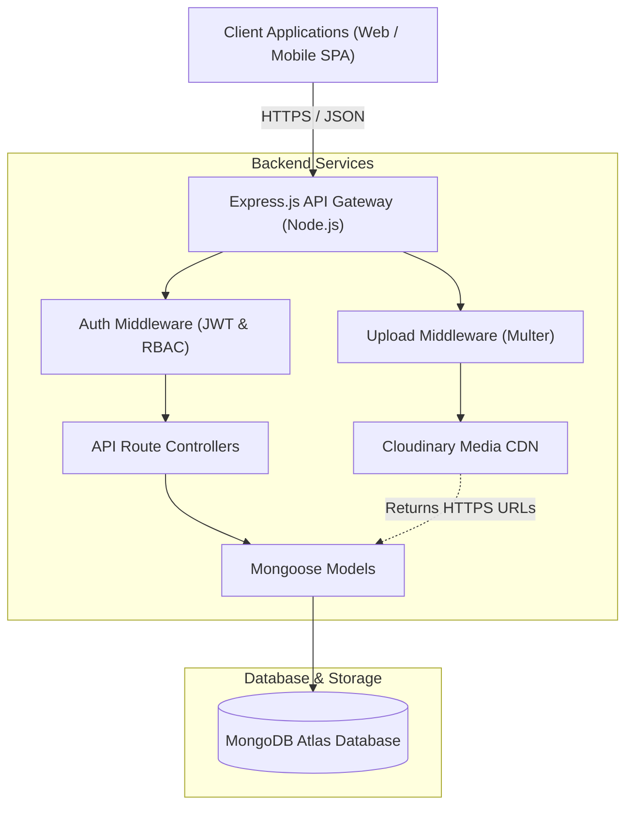
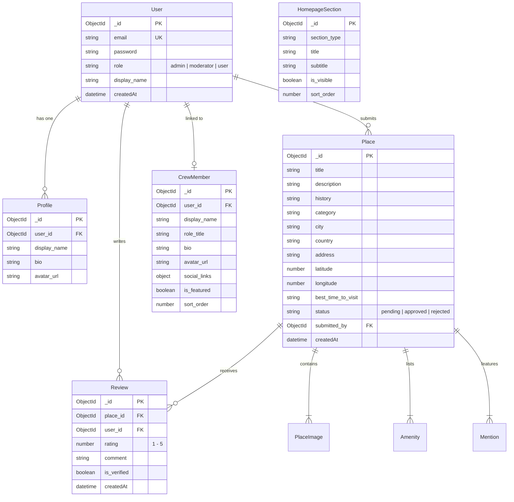

# Agra LocTour — Comprehensive Project Documentation

> **Document Version:** 1.1.0  
> **Last Updated:** October 2026  
> **Repository:** `agra-loctour-backend` (Local Gems Explorer)

---

## 1. Executive Summary & Vision

**Agra LocTour** (Local Gems Explorer) is a community-driven travel platform and RESTful backend service built to uncover, catalog, and share off-the-beaten-path destinations, historical architecture, secret culinary alleys, and cultural experiences in Agra and surrounding heritage corridors.

While conventional tourism platforms focus almost exclusively on iconic, commercialized landmarks like the Taj Mahal and Agra Fort, **Agra LocTour** empowers travelers and passionate local residents to discover hidden gems—such as riverside Persian gardens, acoustic whispering crypts, centuries-old family sweetshops, and riverfront kayaking trails.

---

## 2. System Architecture

The project is structured as a decoupled, multi-tiered Client-Server architecture. The backend provides a stateless JSON REST API secured with JSON Web Tokens (JWT) and backed by MongoDB Atlas and Cloudinary CDN for multimedia assets.

### High-Level Architecture Diagram

---

## 3. Core Feature Specifications

### 3.1 User Management & Role-Based Access Control (RBAC)
- **Multi-Role System**:
  - `user` (Explorer): Can browse approved places, submit new locations, upload photos, leave reviews, and personalize their profile.
  - `moderator`: Can approve/reject submissions, moderate amenities, verify community reviews, and manage mentions.
  - `admin`: Has complete root control over platform configuration, user roles, homepage layout, and crew appointments.
- **Security Protocols**:
  - Salted and hashed passwords using `bcryptjs` (10 rounds).
  - Stateless authentication using signed JSON Web Tokens (`jsonwebtoken`) with configurable expiry (`7d`).
  - Pre-save hooks ensuring secure password transformation and JSON sanitization (passwords are automatically stripped in responses).

---

### 3.2 Place Discovery & Submission Engine
- **Rich Multi-Attribute Data Model**:
  - **Core Details**: Title, in-depth description, historical narrative, city, country.
  - **Geolocation & Mapping**: Street address along with precise `latitude` and `longitude` coordinates for interactive map rendering and routing.
  - **Category Taxonomy**: Strict enum validation across 7 curated categories:
    - ☕ `cafes`: Hidden alleys, specialty roasters, themed gathering spots.
    - 🛕 `temples`: Ancient shrines, forgotten stepwells, architectural monuments.
    - 🌿 `nature`: Forest groves, wetland bird sanctuaries, scenic waterfalls.
    - 🍲 `food`: Legacy street-food stalls, multi-generational family kitchens.
    - 🗝️ `mystery`: Abandoned ruins, subterranean chambers, acoustic crypts.
    - 🚣 `sports`: River kayaking, rowing, trail trekking.
    - 🎨 `fun-activity`: Pietra Dura marble inlay workshops, pottery classes.
- **Amenities Checklist**:
  - Tracks key visitor conveniences: `Parking`, `Drinking Water`, `Washroom`, `Network`, `Shade`, `Benches`, `Safety`.
  - Status indicator: `available`, `limited`, or `unavailable`.
- **Cultural & Media Mentions**:
  - Highlights books, films, and social media creators referencing the spot (`Movie`, `Book`, `Social`) with source links.
- **Moderation Workflow**:
  - Places default to `pending` status upon user submission.
  - Admins and moderators review photos and text before changing status to `approved` or `rejected`.

---

### 3.3 DaGama Crew (Curated Community Explorers)
- **Dedicated Explorer Network**:
  - Highlights leading local curators (e.g., *Temple Hunter*, *Café Connoisseur*, *Trail Blazer*, *Mystery Seeker*).
  - Profiles include custom role titles, biographies, avatar headshots, and external social media links (Instagram, Twitter, personal sites).
- **Automated Live Contribution Counters**:
  - Dynamically calculates the total number of approved places submitted and community reviews posted by each crew member.
  - Enables community members to see verifiable trust badges on user-submitted content.

---

### 3.4 Community Reviews & Quality Assurance
- **Rating Matrix**: 1-to-5 star ratings combined with rich textual feedback.
- **Verification System**: Dedicated `is_verified` flag allowing moderators to certify authentic in-person visits.
- **Aggregation & Sorting**:
  - Filter places by category.
  - Sort places by rating (highest first), review count (popularity), or recent creation.
  - Limit and pagination parameters for high-performance frontend feeds.

---

### 3.5 Dynamic Homepage Content Management
- **Modular Sections**:
  - Supports dynamic sections: `hero`, `categories`, `trending`, `top_rated`, `recently_added`, `crew`, and `cta`.
- **Content Flexibility**:
  - Admins can re-order sections (`sort_order`), customize marketing headlines and subtitles, or toggle visibility (`is_visible`) on the fly without deploying code changes.

---

### 3.6 Admin Intelligence & Moderation Suite
- **Platform Analytics**:
  - Aggregate counters: Total registered users, approved places, pending submissions, rejected places, and total reviews.
  - Real-time audit activity feed capturing place submissions and reviews with timestamps.
- **Micro-Moderation Tools**:
  - Bulk amenity review and status updates across places.
  - Image review with individual image deletion support.
  - Mention management with status update and delete capabilities.

---

### 3.7 Database Seeding Engine
- **Idempotent Seeder (`src/seed.js`)**:
  - Provides sample data across all 6 collections: 5 test user accounts, 7 homepage sections, 16 comprehensive places (including authentic Agra locations), 24 reviews, and 4 DaGama Crew profiles.
  - Running `npm run seed` performs non-destructive upserts to preserve existing data while adding new fields.
  - Running `npm run seed:fresh` drops all collections and seeds fresh data.

---

## 4. Entity Relationship Diagram (ERD)

---

## 5. Security & Validation Standards

1. **Token Authentication**: HTTP `Authorization: Bearer <token>` header verified through custom Express middleware.
2. **Access Control (RBAC)**: Custom `requireRole("admin", "moderator")` guards applied to all management routes.
3. **Password Security**: Bcrypt hash generation handled asynchronously before document persist (`pre('save')`).
4. **Data Validation**: Mongoose schema-level constraints on required fields, trimming, regex matching, and enums.
5. **CORS & Environment Isolation**: Configured via `cors` middleware with customizable origin restriction (`CLIENT_URL`).

---

## 6. Future Roadmap

- [ ] **Interactive Geo-Clustering**: Mapbox / Leaflet map integration with distance calculations using MongoDB `$near` geospatial queries.
- [ ] **Custom Itineraries & Bookmarks**: Save favorite hidden gems into shareable community travel itineraries.
- [ ] **Explorer Badges & Gamification**: Award automated profile badges based on user submissions and verified reviews.
- [ ] **Offline PWA Support**: Progressive Web App caching for travelers in low-connectivity areas.
- [ ] **Multi-language Support**: Localized audio guides and descriptions in Hindi and English.
